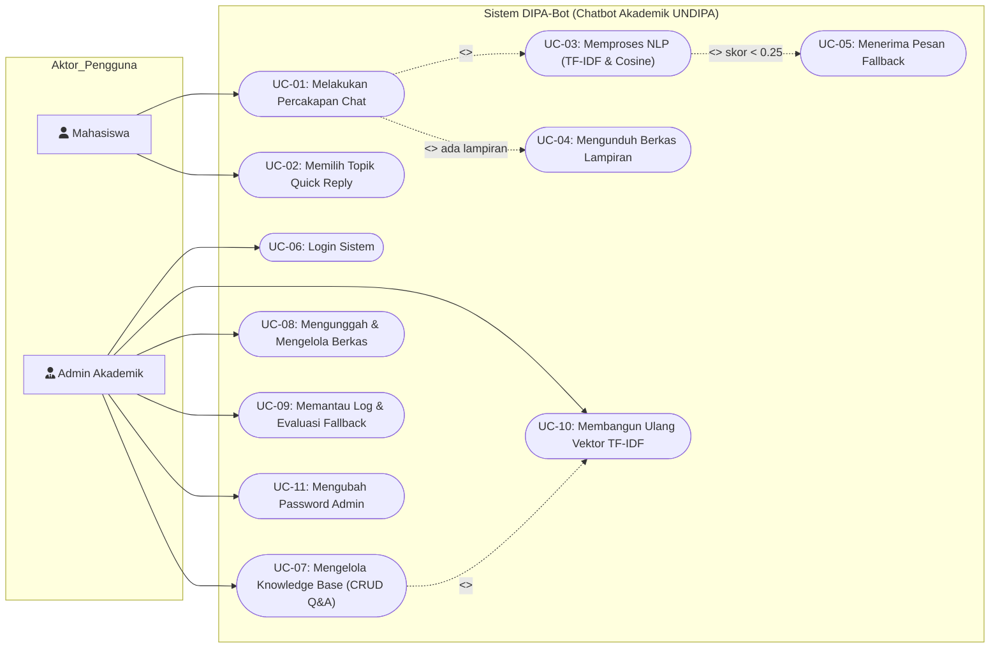
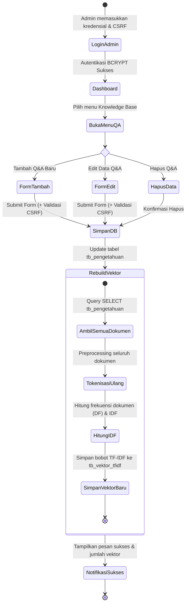
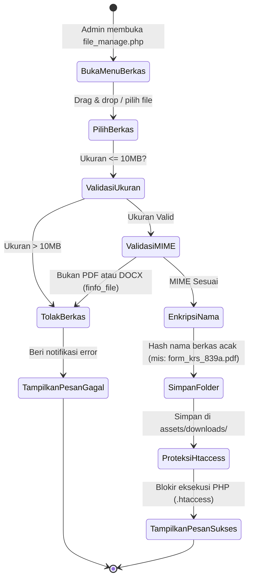
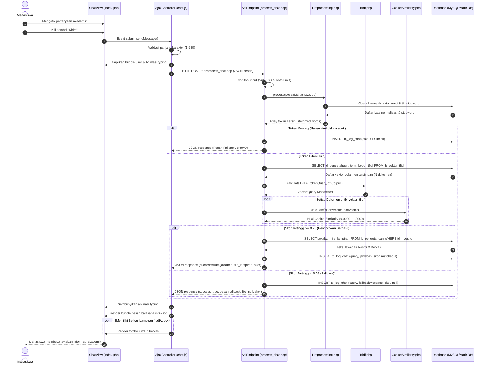
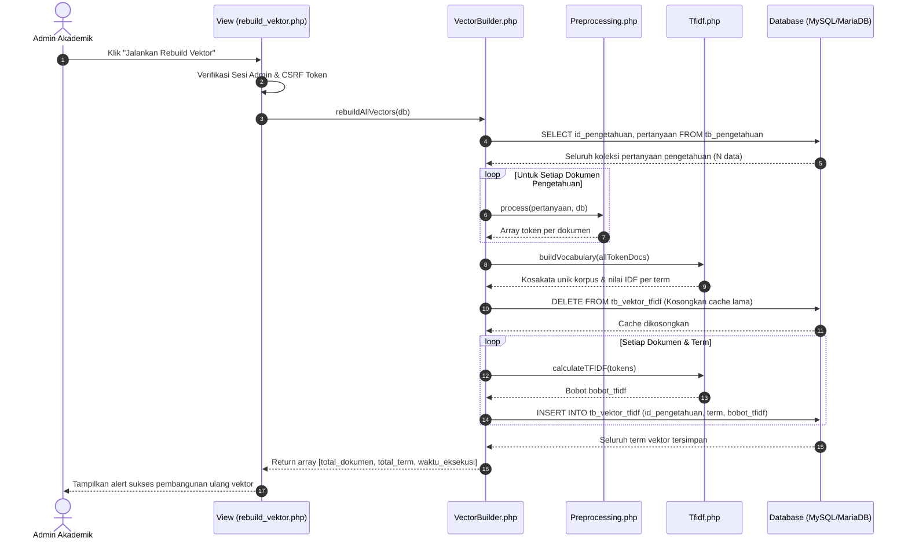
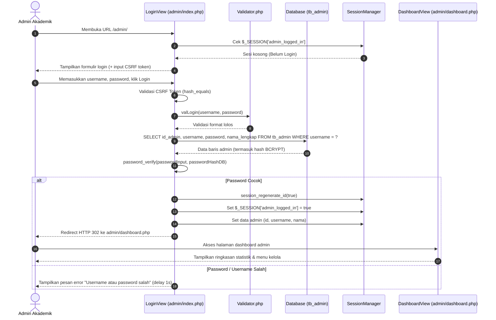

# DOKUMENTASI PEMODELAN UML SISTEM (REVISI SKRIPSI)
## DIPA-Bot — Chatbot Akademik Universitas Dipa Makassar Berbasis NLP

> **Judul Skripsi:** Pengembangan Chatbot Cerdas Berbasis Web Menggunakan Natural Language Processing (NLP) Untuk Layanan Akademik Pada Universitas Dipa Makassar  
> **Peneliti:** Mohammad Ali Riedza  
> **NIM:** 221084  
> **Program Studi:** Sistem Informasi (S1) — Universitas Dipa Makassar  
> **Dasar Revisi:** Lembar Koreksi Skripsi (Perbaikan Use Case Diagram, Perbaikan Activity Diagram, dan Penambahan Sequence Diagram).

---

## DAFTAR ISI
1. [Pendahuluan & Konteks Sistem](#1-pendahuluan--konteks-sistem)
2. [Use Case Diagram (Diperbaiki)](#2-use-case-diagram-diperbaiki)
   - 2.1 Diagram Visual Use Case (Mermaid)
   - 2.2 Deskripsi Aktor
   - 2.3 Tabel Skenario Use Case
3. [Activity Diagram (Diperbaiki)](#3-activity-diagram-diperbaiki)
   - 3.1 Activity Diagram Tanya Jawab Chatbot (Proses NLP)
   - 3.2 Activity Diagram Pengelolaan Q&A dan Rebuild Vektor
   - 3.3 Activity Diagram Unggah Dokumen Akademik
4. [Sequence Diagram (Diagram Baru)](#4-sequence-diagram-diagram-baru)
   - 4.1 Sequence Diagram Alur Chat Mahasiswa (NLP Matching)
   - 4.2 Sequence Diagram Rebuild Vektor TF-IDF Knowledge Base
   - 4.3 Sequence Diagram Login & Autentikasi Admin
5. [Petunjuk Penyalinan ke Naskah Skripsi](#5-petunjuk-penyalinan-ke-naskah-skripsi)

---

## 1. Pendahuluan & Konteks Sistem
DIPA-Bot adalah sistem layanan informasi akademik interaktif 24/7 untuk mahasiswa Universitas Dipa Makassar. Sistem memproses pertanyaan teks bebas mahasiswa dengan tahapan Natural Language Processing (NLP):
1. **Preprocessing:** *Case Folding, Filtering, Normalisasi Kata (Kamus Typo/Singkatan), Tokenizing, Stopword Removal, dan Stemming*.
2. **Pembobotan & Pengukuran Similarity:** *Term Frequency – Inverse Document Frequency (TF-IDF)* dan *Cosine Similarity* dengan ambang batas (*threshold*) $\ge 0.25$.
3. **Penyajian Respons:** Menampilkan jawaban resmi akademik serta tombol pengunduhan dokumen lampiran (`.pdf`/`.docx`) bila tersedia.
4. **Panel Administrasi:** Tempat admin mengelola knowledge base 10 topik akademik, mengunggah berkas, memonitor log percakapan, dan menjalankan *rebuild* vektor TF-IDF.

---

## 2. Use Case Diagram (Diperbaiki)

Use Case Diagram menggambarkan fungsionalitas sistem dari sudut pandang pengguna (aktor). Relasi `<<include>>` digunakan untuk proses wajib yang selalu dieksekusi bersamaan, sedangkan `<<extend>>` digunakan untuk kondisi bersyarat (kondisional).

### 2.1 Diagram Visual Use Case



---

### 2.2 Deskripsi Aktor
| No | Aktor | Jenis | Deskripsi Peran |
|:--:|:---|:---|:---|
| 1 | **Mahasiswa** | Aktor Primer | Pengguna layanan yang mengajukan pertanyaan seputar informasi akademik melalui antarmuka web, memanfaatkan tombol *quick reply*, dan mengunduh berkas pedoman akademik. |
| 2 | **Admin Akademik** | Aktor Primer | Staf pengelola layanan informasi akademik yang bertugas memelihara data pengetahuan Q&A, mengunggah berkas resmi, mengawasi log percakapan, dan memperbarui cache vektor TF-IDF. |

---

### 2.3 Tabel Skenario Use Case

#### Skenario UC-01: Melakukan Percakapan Chat
* **Aktor:** Mahasiswa
* **Deskripsi:** Mahasiswa mengirimkan pertanyaan teks seputar 10 topik akademik UNDIPA (KRS, MBKM, Cuti, Skripsi, dll.).
* **Kondisi Awal (*Pre-condition*):** Mahasiswa membuka halaman web utama DIPA-Bot.
* **Alur Utama (*Main Flow*):**
  1. Mahasiswa mengetik pertanyaan pada input teks (1–250 karakter) dan menekan tombol "Kirim".
  2. Sistem melakukan validasi klien dan menampilkan indikator animasi mengetik (*typing indicator*).
  3. Sistem menjalankan pra-pemrosesan teks NLP (*Preprocessing*) dan menghitung kemiripan vektor (*Cosine Similarity*).
  4. Sistem menemukan jawaban di `tb_pengetahuan` dengan skor $\ge 0.25$.
  5. Sistem mencatat transaksi percakapan ke `tb_log_chat`.
  6. Sistem menampilkan bubble balasan bot di layar percakapan mahasiswa.
* **Alur Alternatif (*Alternative Flow*):**
  - Jika skor kemiripan $< 0.25$: Sistem menampilkan balasan *Fallback* yang meminta mahasiswa memperjelas pertanyaan.
  - Jika pertanyaan memiliki dokumen lampiran: Sistem memunculkan tombol unduhan dokumen (`.pdf`/`.docx`).
* **Kondisi Akhir (*Post-condition*):** Pertanyaan terjawab dan tercatat di basis data log sistem.

#### Skenario UC-07: Mengelola Knowledge Base (CRUD Q&A)
* **Aktor:** Admin Layanan Akademik
* **Deskripsi:** Menambah, mengubah, atau menghapus pasangan tanya-jawab pengetahuan akademik.
* **Kondisi Awal:** Admin telah berhasil login ke panel dashboard admin.
* **Alur Utama:**
  1. Admin membuka menu *Knowledge Base* (`qa_manage.php`).
  2. Admin memilih aksi (Tambah / Edit / Hapus data Q&A).
  3. Admin mengisi form (Pertanyaan, Jawaban, Kategori topik, File lampiran).
  4. Sistem memvalidasi CSRF token dan kelengkapan input.
  5. Sistem menyimpan perubahan ke tabel `tb_pengetahuan`.
  6. Sistem secara otomatis memicu pembaruan bobot vektor di `tb_vektor_tfidf`.
* **Kondisi Akhir:** Basis pengetahuan terbarui dan vektor dokumen siap dicocokkan.

---

## 3. Activity Diagram (Diperbaiki)

### 3.1 Activity Diagram Tanya Jawab Chatbot (Proses NLP Mahasiswa)
Diagram ini memodelkan aliran aktivitas saat mahasiswa bertanya hingga bot memberikan jawaban:

```mermaid
activity
stateDiagram-v2
    [*] --> BukaHalaman: Mahasiswa mengakses web DIPA-Bot
    BukaHalaman --> InputTeks: Mahasiswa mengetik pesan (1-250 char)
    InputTeks --> ValidasiKlien: Klik tombol Kirim
    
    state ValidasiKlien <<choice>>
    ValidasiKlien --> InputTeks: Teks kosong / >250 char (Tolak)
    ValidasiKlien --> KirimAjax: Input Valid
    
    KirimAjax --> TampilTyping: Tampilkan Animasi Mengetik
    TampilTyping --> SanitasiServer: Kirim HTTP POST JSON ke API
    
    SanitasiServer --> Preprocessing: Pembersihan XSS & Tag HTML
    
    state Preprocessing {
        [*] --> CaseFolding: Ubah huruf kecil (lowercase)
        CaseFolding --> Filtering: Hapus angka & tanda baca
        Filtering --> Normalisasi: Cocokkan kamus tb_kata_kunci (typo/singkatan)
        Normalisasi --> Tokenizing: Pecah string menjadi array token
        Tokenizing --> Stopword: Buang kata hubung (tb_stopword)
        Stopword --> Stemming: Ubah ke kata dasar
        Stemming --> [*]
    }
    
    Preprocessing --> CekToken: Hasil token ada?
    
    state CekToken <<choice>>
    CekToken --> SetFallback: Token Kosong
    CekToken --> HitungTfidf: Token Tersedia
    
    HitungTfidf --> HitungCosine: Vektorisasi Pertanyaan & Ambil tb_vektor_tfidf
    HitungCosine --> EvaluasiSkor: Hitung Cosine Similarity semua dokumen
    
    state EvaluasiSkor <<choice>>
    EvaluasiSkor --> AmbilJawaban: Skor Tertinggi >= 0.25
    EvaluasiSkor --> SetFallback: Skor Tertinggi < 0.25
    
    AmbilJawaban --> SimpanLog: Ambil jawaban & nama file lampiran
    SetFallback --> SimpanLog: Siapkan pesan permohonan maaf (fallback)
    
    SimpanLog --> KirimJson: Simpan ke tb_log_chat (skor, IP, User-Agent)
    KirimJson --> RenderUI: Kembalikan JSON ke browser
    RenderUI --> [*]: Sembunyikan animasi & tampilkan bubble bot
```

---

### 3.2 Activity Diagram Pengelolaan Q&A dan Rebuild Vektor
Diagram aktivitas saat admin mengelola basis pengetahuan:



---

### 3.3 Activity Diagram Unggah Dokumen Akademik
Diagram saat admin mengunggah dokumen pedoman (`.pdf`/`.docx`):



---

## 4. Sequence Diagram (Diagram Baru)

> **Catatan Khusus Penguji:** Diagram ini ditambahkan secara khusus untuk memenuhi instruksi lembar koreksi dosen (*"Tidak menggambarkan sequence diagram"*).

Sequence Diagram memodelkan interaksi antar-objek/komponen dalam rentang waktu tertentu.

### 4.1 Sequence Diagram Alur Chat Mahasiswa (NLP Matching)

Diagram ini menunjukkan interaksi dari mahasiswa, tampilan antarmuka, pengontrol AJAX, endpoint API, modul pemrosesan teks NLP, hingga database MySQL:



---

### 4.2 Sequence Diagram Rebuild Vektor TF-IDF Knowledge Base

Diagram interaksi saat admin melakukan *rebuild* vektor (baik melalui penambahan Q&A di `qa_manage.php` maupun menu mandiri `rebuild_vektor.php`):



---

### 4.3 Sequence Diagram Login & Autentikasi Admin

Diagram interaksi keamanan saat admin melakukan autentikasi ke dalam sistem:



---

## 5. Petunjuk Penyalinan ke Naskah Skripsi

Untuk memasukkan diagram-diagram di atas ke dalam naskah Skripsi Microsoft Word:

1. **Menggunakan Visual Mermaid Langsung:**
   - Anda dapat membuka [Mermaid Live Editor](https://mermaid.live/) di browser.
   - Salin blok kode `mermaid` di atas dan tempelkan ke editor tersebut.
   - Klik tombol **Download PNG** atau **Download SVG** beresolusi tinggi, kemudian sisipkan (*Insert Picture*) ke dalam naskah Word Anda pada **Bab III (Metodologi Penelitian / Analisis & Perancangan Sistem)**.
2. **Penempatan Bab Skripsi:**
   - **Sub-bab Use Case Diagram:** Masukkan Diagram 2.1, Deskripsi Aktor 2.2, dan Tabel Skenario 2.3.
   - **Sub-bab Activity Diagram:** Masukkan Diagram 3.1 (Alur Chat NLP), 3.2 (Kelola Pengetahuan), dan 3.3 (Unggah Berkas).
   - **Sub-bab Sequence Diagram:** Masukkan Diagram 4.1 (Tanya Jawab NLP), 4.2 (Rebuild Vektor), dan 4.3 (Login Admin).
3. **Format Notasi:** Seluruh diagram telah mematuhi standar UML 2.5 dan merefleksikan 100% implementasi riil kode program sistem DIPA-Bot.
